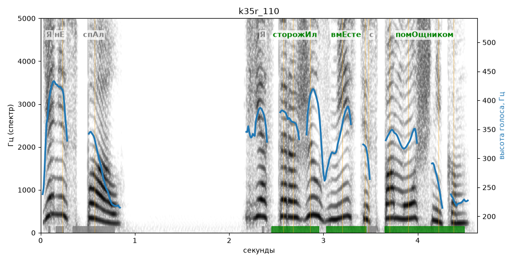

# k35r_110

Голос: **Рон, сборка 35d** · длительность 4.6 с
Эталон: Я не спал! Я сторожил вместе с помощником!
Распознано: Я не спал. Я старожил вместе с помощником.
Расхождения в словах: «сторожил» → «старожил»

## Ударения
(где нужно: ruaccent)

| слово | нужно | у голоса | |
|---|---|---|---|
| сторожил | сторожИл | сторожИл | ✓ |
| вместе | вмЕсте | вмЕсте | ✓ |
| помощником | помОщником | помОщником | ✓ |

## Интонация
- ✓ «я сторожил вместе с помощником!» — выделено слово «сторожил» (+3.2 пт)
- Диапазон голоса 11.1 полутонов (живо), средняя высота 338 Гц

## Паузы и темп
- паузы на своих местах
- Темп 4.2 слога/с (нормально)

_Синяя линия — высота голоса. Над словами заглавная буква — где ударение должно быть; красным — голос поставил не туда (уверенно), оранжевым — возможно._
