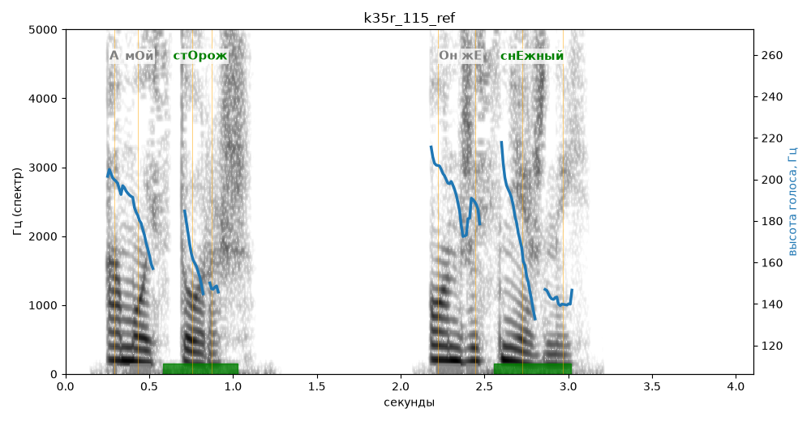

# k35r_115_ref

Голос: **edge:ru-RU-SvetlanaNeural** · длительность 4.1 с
Эталон: А мой сторож? Он же снежный!
Распознано: А мой сторож. Он же снежный.
Слова: все совпали

## Ударения
(где нужно: ruaccent)

| слово | нужно | у голоса | |
|---|---|---|---|
| сторож | стОрож | стОрож | ✓ |
| снежный | снЕжный | снЕжный | ✓ |

## Интонация
- ✗ «а мой сторож?» — нет вопросительного подъёма (самое высокое место — «а», в начале) — звучит как утверждение
- ✓ «он же снежный!» — выделено слово «он» (+2.3 пт)
- Диапазон голоса 6.8 полутонов (нормально), средняя высота 179 Гц

## Паузы и темп
- паузы на своих местах
- Темп 5.2 слога/с (нормально)

_Синяя линия — высота голоса. Над словами заглавная буква — где ударение должно быть; красным — голос поставил не туда (уверенно), оранжевым — возможно._
