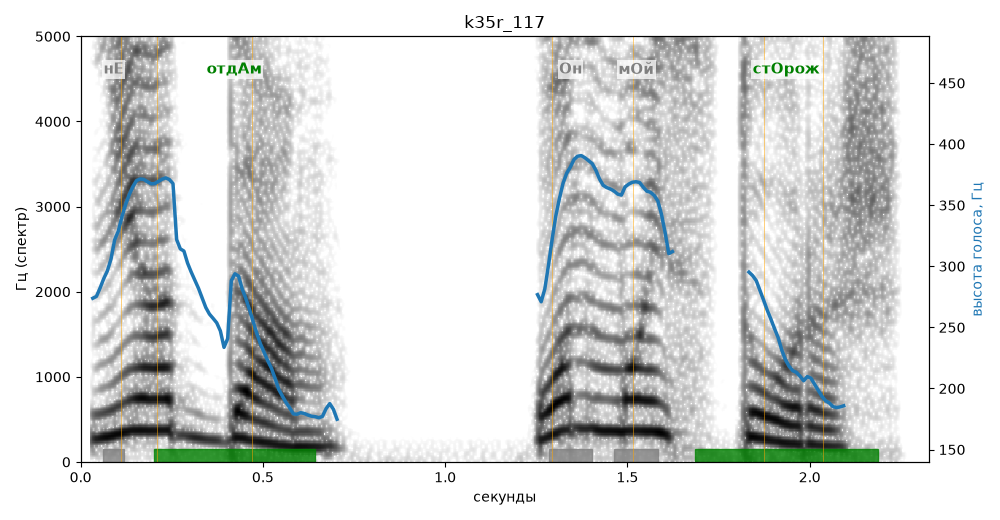

# k35r_117

Голос: **Рон, сборка 35d** · длительность 2.3 с
Эталон: Не отдам! Он мой сторож!
Распознано: Не отдам. Он мой сторож.
Слова: все совпали

## Ударения
(где нужно: ruaccent)

| слово | нужно | у голоса | |
|---|---|---|---|
| отдам | отдАм | отдАм | ✓ |
| сторож | стОрож | стОрож | ✓ |

## Интонация
- ✗ «не отдам!» — восклицание звучит ровно, без эмоции
- ✓ «он мой сторож!» — выделено слово «он» (+3.4 пт)
- Диапазон голоса 13.0 полутонов (живо), средняя высота 288 Гц

## Паузы и темп
- паузы на своих местах
- Темп 4.7 слога/с (нормально)

_Синяя линия — высота голоса. Над словами заглавная буква — где ударение должно быть; красным — голос поставил не туда (уверенно), оранжевым — возможно._
