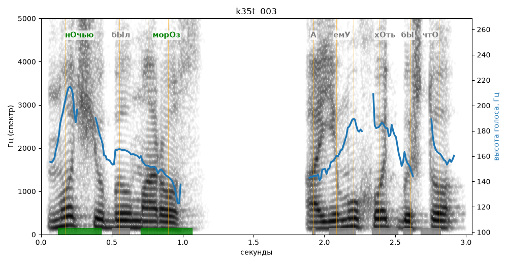

# k35t_003

Голос: **Топа, сборка 35d** · длительность 3.0 с
Эталон: Ночью был мороз. А ему хоть бы что!
Распознано: ночью был мороз, а ему хоть бы что.
Слова: все совпали

## Ударения
(где нужно: ruaccent)

| слово | нужно | у голоса | |
|---|---|---|---|
| ночью | нОчью | нОчью | ✓ |
| мороз | морОз | морОз | ✓ |
| ему | емУ | Ему | ? не разобрать |

## Интонация
- ✓ «ночью был мороз.» — конец фразы понижается — звучит законченно
- ✓ «а ему хоть бы что!» — выделено слово «хоть» (+2.4 пт)
- Диапазон голоса 5.6 полутонов (нормально), средняя высота 161 Гц

## Паузы и темп
- паузы на своих местах
- Темп 5.4 слога/с (нормально)

_Синяя линия — высота голоса. Над словами заглавная буква — где ударение должно быть; красным — голос поставил не туда (уверенно), оранжевым — возможно._
