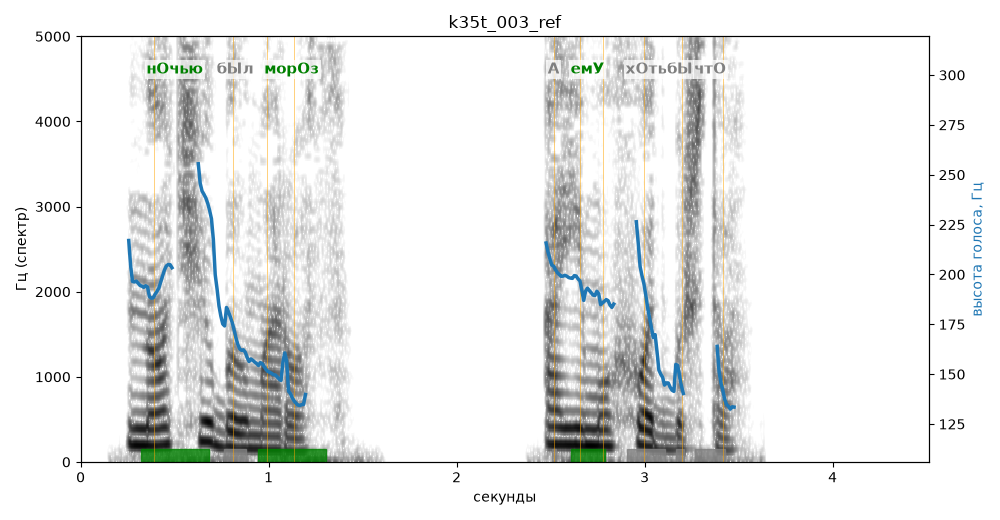

# k35t_003_ref

Голос: **edge:ru-RU-SvetlanaNeural** · длительность 4.5 с
Эталон: Ночью был мороз. А ему́ хоть бы что!
Распознано: ночью был мороз, а ему ход бы что?
Расхождения в словах: «хоть» → «ход»

## Ударения
(где нужно: ruaccent)

| слово | нужно | у голоса | |
|---|---|---|---|
| ночью | нОчью | нОчью | ✓ |
| мороз | морОз | морОз | ✓ |
| ему | емУ | емУ | ✓ |

## Интонация
- ✓ «ночью был мороз.» — конец фразы понижается — звучит законченно
- ✗ «а ему хоть бы что!» — восклицание звучит ровно, без эмоции
- Диапазон голоса 9.0 полутонов (живо), средняя высота 184 Гц

## Паузы и темп
- паузы на своих местах
- Темп 5.2 слога/с (нормально)

_Синяя линия — высота голоса. Над словами заглавная буква — где ударение должно быть; красным — голос поставил не туда (уверенно), оранжевым — возможно._
