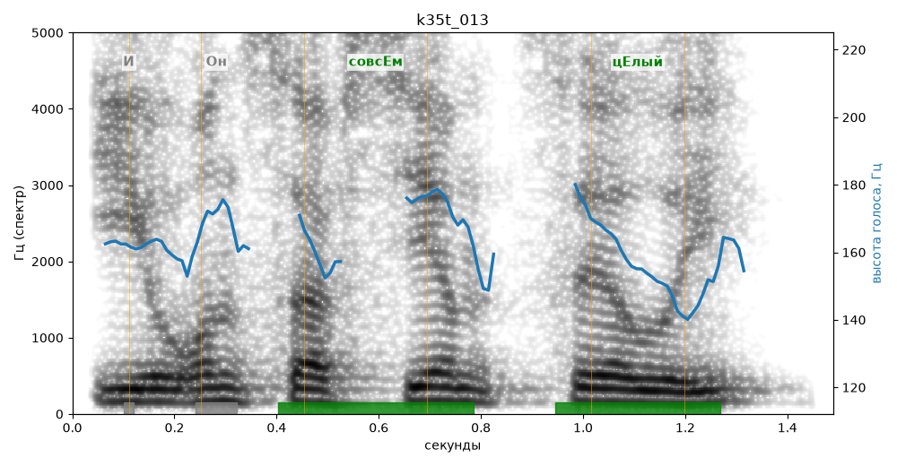

# k35t_013

Голос: **Топа, сборка 35d** · длительность 1.5 с
Эталон: И он совсем целый!
Распознано: и он совсем целый.
Слова: все совпали

## Ударения
(где нужно: ruaccent)

| слово | нужно | у голоса | |
|---|---|---|---|
| совсем | совсЕм | совсЕм | ✓ |
| целый | цЕлый | цЕлый | ✓ |

## Интонация
- ✗ «и он совсем целый!» — восклицание звучит ровно, без эмоции
- Диапазон голоса 3.4 полутонов (монотонно, как робот), средняя высота 162 Гц

## Паузы и темп
- паузы на своих местах
- Темп 6.0 слога/с (нормально)

_Синяя линия — высота голоса. Над словами заглавная буква — где ударение должно быть; красным — голос поставил не туда (уверенно), оранжевым — возможно._
