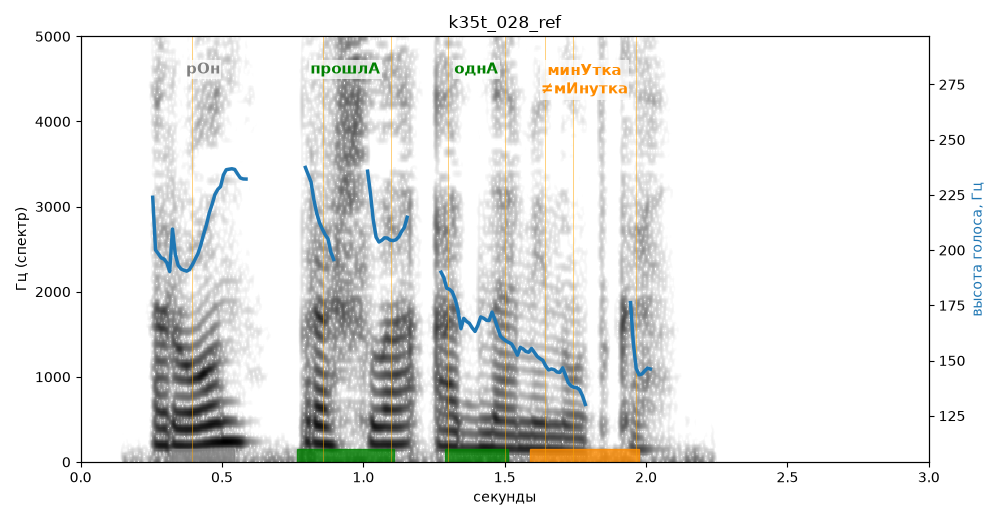

# k35t_028_ref

Голос: **edge:ru-RU-SvetlanaNeural** · длительность 3.0 с
Эталон: Рон, прошла одна минутка!
Распознано: Рон прошла 1 минутка.
Расхождения в словах: «одна» → «1»

## Ударения
(где нужно: ruaccent)

| слово | нужно | у голоса | |
|---|---|---|---|
| прошла | прошлА | прошлА | ✓ |
| одна | однА | однА | ✓ |
| минутка | минУтка | мИнутка | ✗? возможно — послушать |

## Интонация
- ✓ «рон прошла одна минутка!» — выделено слово «прошла» (+3.7 пт)
- Диапазон голоса 9.0 полутонов (живо), средняя высота 190 Гц

## Паузы и темп
- паузы на своих местах
- Темп 6.4 слога/с (нормально)

_Синяя линия — высота голоса. Над словами заглавная буква — где ударение должно быть; красным — голос поставил не туда (уверенно), оранжевым — возможно._
