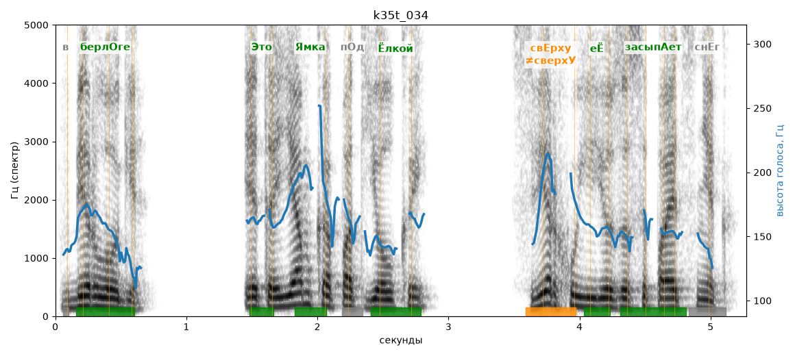

# k35t_034

Голос: **Топа, сборка 35d** · длительность 5.3 с
Эталон: В берлоге. Это ямка под ёлкой. Сверху её засыпает снег.
Распознано: в бирлоге. Это ямко подъелкой. Сверху ее засыпает снег.
Расхождения в словах: «берлоге» → «бирлоге»; «ямка под елкой» → «ямко подъелкой»

## Ударения
(где нужно: ruaccent)

| слово | нужно | у голоса | |
|---|---|---|---|
| берлоге | берлОге | берлОге | ✓ |
| это | Это | Это | ✓ |
| ямка | Ямка | Ямка | ✓ |
| ёлкой | Ёлкой | Ёлкой | ✓ |
| сверху | свЕрху | сверхУ | ✗? возможно — послушать |
| её | еЁ | еЁ | ✓ |
| засыпает | засыпАет | засыпАет | ✓ |

## Интонация
- ✗ «в берлоге.» — конец фразы не понижается — звучит незаконченно / как перечисление
- ✓ «это ямка под ёлкой.» — конец фразы понижается — звучит законченно
- ✓ «сверху её засыпает снег.» — конец фразы понижается — звучит законченно
- Диапазон голоса 7.0 полутонов (живо), средняя высота 158 Гц

## Паузы и темп
- паузы на своих местах
- Темп 5.9 слога/с (нормально)

_Синяя линия — высота голоса. Над словами заглавная буква — где ударение должно быть; красным — голос поставил не туда (уверенно), оранжевым — возможно._
