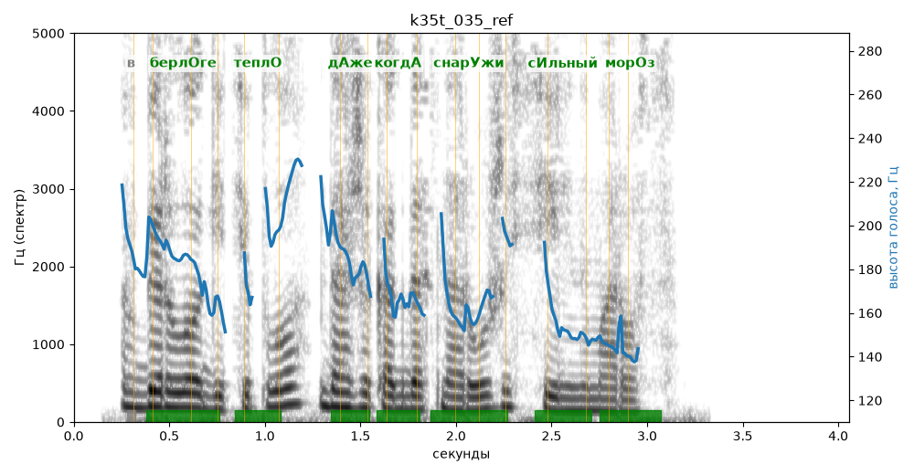

# k35t_035_ref

Голос: **edge:ru-RU-SvetlanaNeural** · длительность 4.1 с
Эталон: В берлоге тепло, даже когда снаружи сильный мороз.
Распознано: В бирлоге тепло даже когда снаружи сильный мороз.
Расхождения в словах: «берлоге» → «бирлоге»

## Ударения
(где нужно: ruaccent)

| слово | нужно | у голоса | |
|---|---|---|---|
| берлоге | берлОге | берлОге | ✓ |
| тепло | теплО | теплО | ✓ |
| даже | дАже | дАже | ✓ |
| когда | когдА | когдА | ✓ |
| снаружи | снарУжи | снарУжи | ✓ |
| сильный | сИльный | сИльный | ✓ |
| мороз | морОз | морОз | ✓ |

## Интонация
- ✓ «в берлоге тепло даже когда снаружи сильный мороз.» — конец фразы понижается — звучит законченно
- Диапазон голоса 7.0 полутонов (живо), средняя высота 171 Гц

## Паузы и темп
- паузы на своих местах
- Темп 6.7 слога/с (быстро)

_Синяя линия — высота голоса. Над словами заглавная буква — где ударение должно быть; красным — голос поставил не туда (уверенно), оранжевым — возможно._
