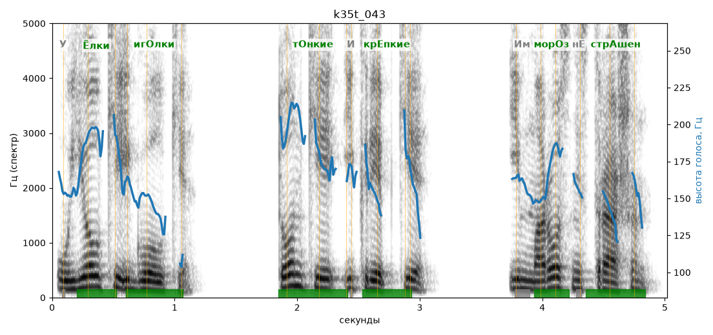

# k35t_043

Голос: **Топа, сборка 35d** · длительность 5.0 с
Эталон: У ёлки иголки. Тонкие и крепкие. Им мороз не страшен.
Распознано: уйдут и голубки, тонкие и крепкие и мороз не страшен.
Расхождения в словах: «у елки иголки» → «уйдут и голубки»; «им» → «и»

## Ударения
(где нужно: ruaccent)

| слово | нужно | у голоса | |
|---|---|---|---|
| ёлки | Ёлки | Ёлки | ✓ |
| иголки | игОлки | игОлки | ✓ |
| тонкие | тОнкие | тОнкие | ✓ |
| крепкие | крЕпкие | крЕпкие | ✓ |
| мороз | морОз | морОз | ✓ |
| страшен | стрАшен | стрАшен | ✓ |

## Интонация
- ✓ «у ёлки иголки.» — конец фразы понижается — звучит законченно
- ✓ «тонкие и крепкие.» — конец фразы понижается — звучит законченно
- ✓ «им мороз не страшен.» — конец фразы понижается — звучит законченно
- Диапазон голоса 7.3 полутонов (живо), средняя высота 162 Гц

## Паузы и темп
- паузы на своих местах
- Темп 6.1 слога/с (нормально)

_Синяя линия — высота голоса. Над словами заглавная буква — где ударение должно быть; красным — голос поставил не туда (уверенно), оранжевым — возможно._
