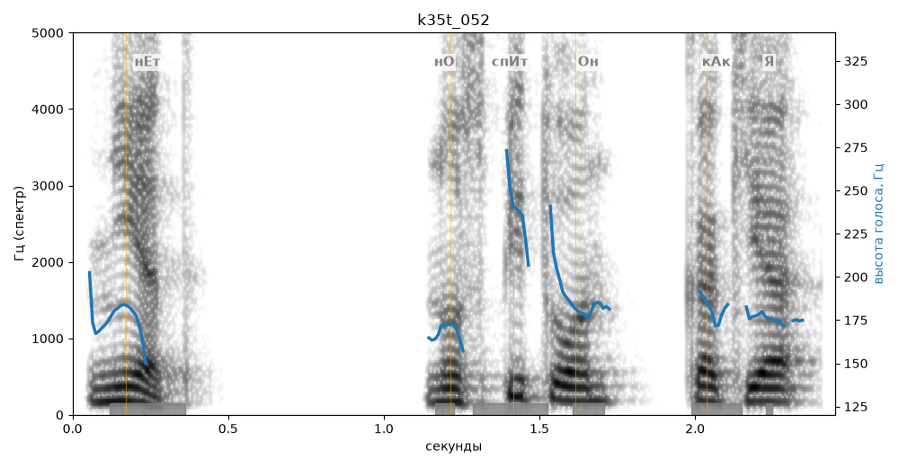

# k35t_052

Голос: **Топа, сборка 35d** · длительность 2.4 с
Эталон: Нет. Но спит он, как я!
Распознано: Нет. Но спит он, как я.
Слова: все совпали

## Ударения
(где нужно: дано в тексте)

| слово | нужно | у голоса | |
|---|---|---|---|

## Интонация
- ✓ «но спит он как я!» — выделено слово «спит» (+4.6 пт)
- Диапазон голоса 6.6 полутонов (нормально), средняя высота 179 Гц

## Паузы и темп
- паузы на своих местах
- Темп 4.8 слога/с (нормально)

_Синяя линия — высота голоса. Над словами заглавная буква — где ударение должно быть; красным — голос поставил не туда (уверенно), оранжевым — возможно._
