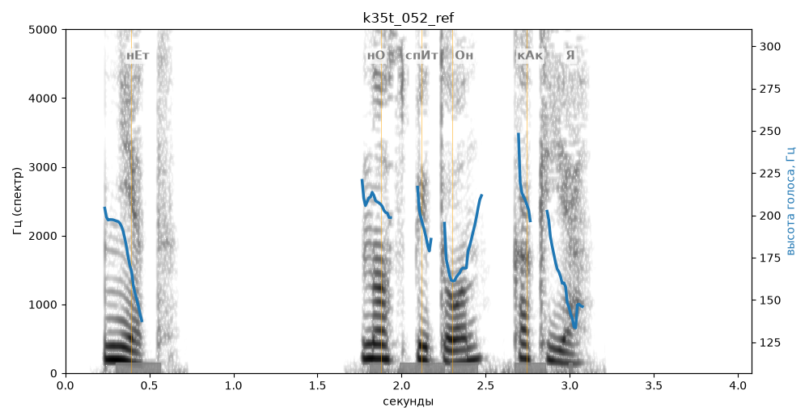

# k35t_052_ref

Голос: **edge:ru-RU-SvetlanaNeural** · длительность 4.1 с
Эталон: Нет. Но спит он, как я!
Распознано: Нет. Но спит он, как я.
Слова: все совпали

## Ударения
(где нужно: дано в тексте)

| слово | нужно | у голоса | |
|---|---|---|---|

## Интонация
- ✗ «но спит он как я!» — восклицание звучит ровно, без эмоции
- Диапазон голоса 7.0 полутонов (живо), средняя высота 190 Гц

## Паузы и темп
- паузы на своих местах
- Темп 4.0 слога/с (нормально)

_Синяя линия — высота голоса. Над словами заглавная буква — где ударение должно быть; красным — голос поставил не туда (уверенно), оранжевым — возможно._
