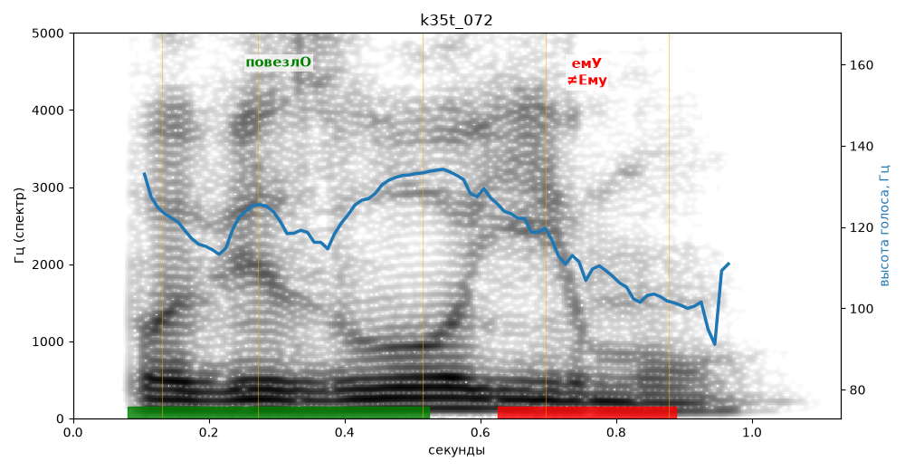

# k35t_072

Голос: **Топа, сборка 35d** · длительность 1.1 с
Эталон: Повезло ему.
Распознано: Повезло ему.
Слова: все совпали

## Ударения
(где нужно: ruaccent)

| слово | нужно | у голоса | |
|---|---|---|---|
| повезло | повезлО | повезлО | ✓ |
| ему | емУ | Ему | ✗ ОШИБКА |

## Интонация
- ✓ «повезло ему.» — конец фразы понижается — звучит законченно
- Диапазон голоса 4.8 полутонов (нормально), средняя высота 119 Гц

## Паузы и темп
- паузы на своих местах
- Темп 6.2 слога/с (нормально)

_Синяя линия — высота голоса. Над словами заглавная буква — где ударение должно быть; красным — голос поставил не туда (уверенно), оранжевым — возможно._
