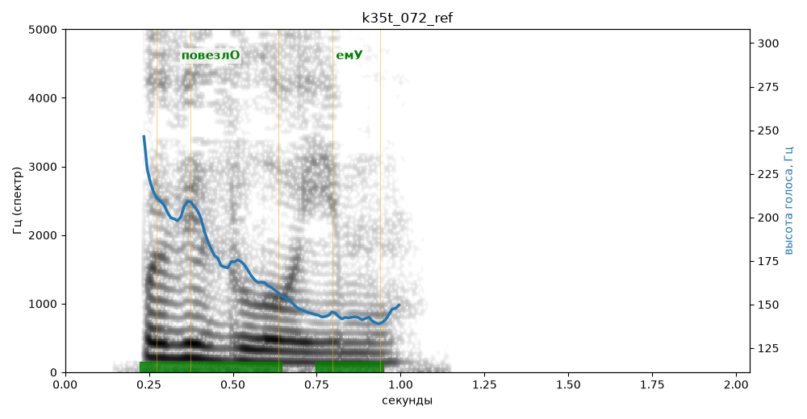

# k35t_072_ref

Голос: **edge:ru-RU-SvetlanaNeural** · длительность 2.0 с
Эталон: Повезло́ ему́.
Распознано: Повезло ему.
Слова: все совпали

## Ударения
(где нужно: дано в тексте)

| слово | нужно | у голоса | |
|---|---|---|---|
| повезло | повезлО | повезлО | ✓ |
| ему | емУ | емУ | ✓ |

## Интонация
- ✓ «повезло ему.» — конец фразы понижается — звучит законченно
- Диапазон голоса 7.0 полутонов (живо), средняя высота 160 Гц

## Паузы и темп
- паузы на своих местах
- Темп 6.9 слога/с (быстро)

_Синяя линия — высота голоса. Над словами заглавная буква — где ударение должно быть; красным — голос поставил не туда (уверенно), оранжевым — возможно._
