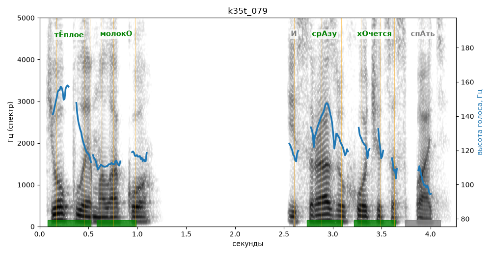

# k35t_079

Голос: **Топа, сборка 35d** · длительность 4.3 с
Эталон: Тёплое молоко. И сразу хочется спать.
Распознано: теплые молоко и сразу хочется спать.
Расхождения в словах: «теплое» → «теплые»

## Ударения
(где нужно: ruaccent)

| слово | нужно | у голоса | |
|---|---|---|---|
| тёплое | тЁплое | тЁплое | ✓ |
| молоко | молокО | молокО | ✓ |
| сразу | срАзу | срАзу | ✓ |
| хочется | хОчется | хОчется | ✓ |

## Интонация
- ✗ «тёплое молоко.» — конец фразы не понижается — звучит незаконченно / как перечисление
- ✓ «и сразу хочется спать.» — конец фразы понижается — звучит законченно
- Диапазон голоса 7.3 полутонов (живо), средняя высота 120 Гц

## Паузы и темп
- паузы на своих местах
- Темп 5.4 слога/с (нормально)

_Синяя линия — высота голоса. Над словами заглавная буква — где ударение должно быть; красным — голос поставил не туда (уверенно), оранжевым — возможно._
