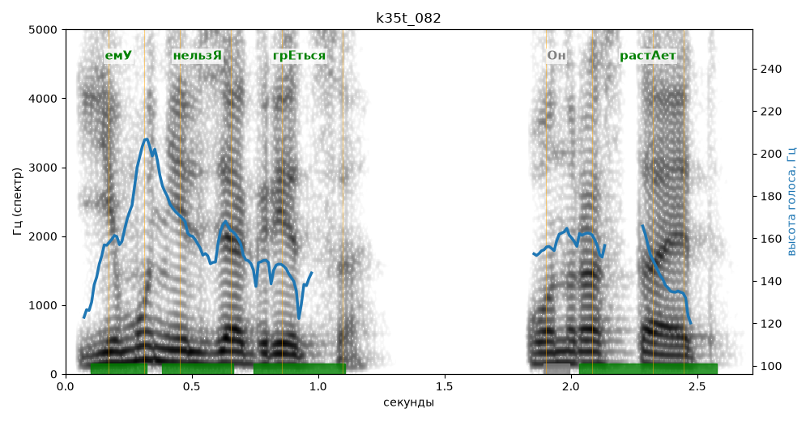

# k35t_082

Голос: **Топа, сборка 35d** · длительность 2.7 с
Эталон: Ему нельзя греться. Он растает.
Распознано: Ему нельзя греться. Он растает.
Слова: все совпали

## Ударения
(где нужно: ruaccent)

| слово | нужно | у голоса | |
|---|---|---|---|
| ему | емУ | емУ | ✓ |
| нельзя | нельзЯ | нельзЯ | ✓ |
| греться | грЕться | грЕться | ✓ |
| растает | растАет | растАет | ✓ |

## Интонация
- ✓ «ему нельзя греться.» — конец фразы понижается — звучит законченно
- ✓ «он растает.» — конец фразы понижается — звучит законченно
- Диапазон голоса 7.2 полутонов (живо), средняя высота 156 Гц

## Паузы и темп
- паузы на своих местах
- Темп 5.9 слога/с (нормально)

_Синяя линия — высота голоса. Над словами заглавная буква — где ударение должно быть; красным — голос поставил не туда (уверенно), оранжевым — возможно._
