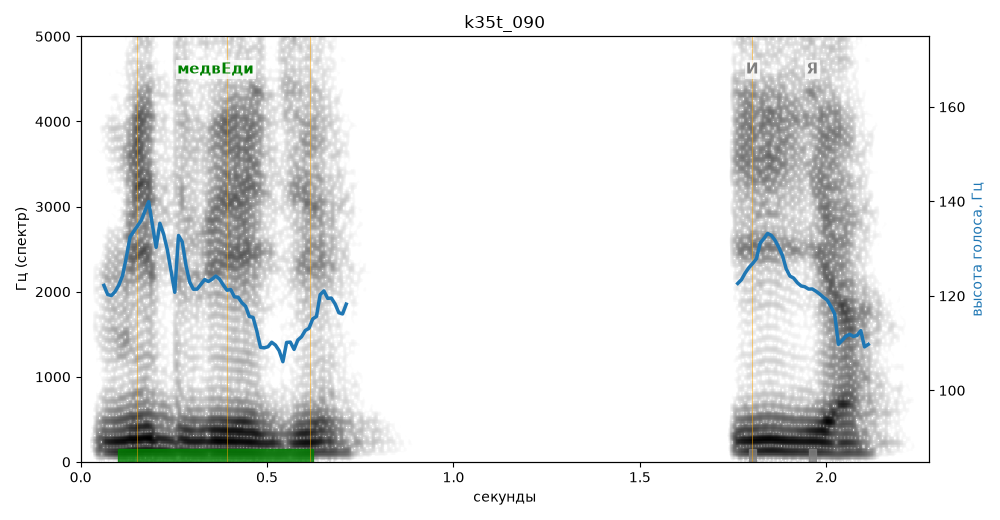

# k35t_090

Голос: **Топа, сборка 35d** · длительность 2.3 с
Эталон: Медведи. И я.
Распознано: Мидведи. И я.
Расхождения в словах: «медведи» → «мидведи»

## Ударения
(где нужно: ruaccent)

| слово | нужно | у голоса | |
|---|---|---|---|
| медведи | медвЕди | медвЕди | ✓ |

## Интонация
- ✗ «медведи.» — конец фразы не понижается — звучит незаконченно / как перечисление
- Диапазон голоса 3.6 полутонов (монотонно, как робот), средняя высота 121 Гц

## Паузы и темп
- паузы на своих местах
- Темп 5.7 слога/с (нормально)

_Синяя линия — высота голоса. Над словами заглавная буква — где ударение должно быть; красным — голос поставил не туда (уверенно), оранжевым — возможно._
