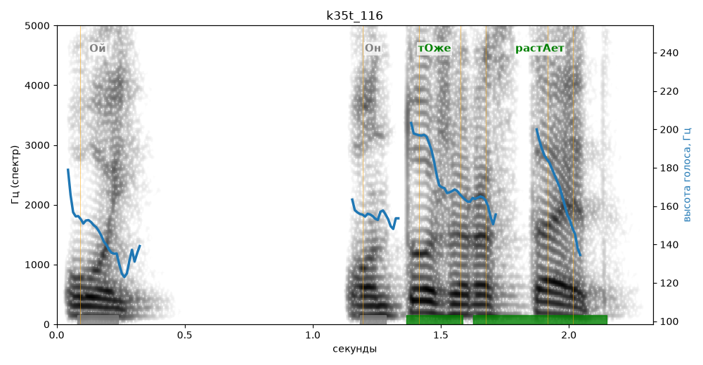

# k35t_116

Голос: **Топа, сборка 35d** · длительность 2.3 с
Эталон: Ой. Он тоже растает?
Распознано: Ой, он тоже растает.
Слова: все совпали

## Ударения
(где нужно: ruaccent)

| слово | нужно | у голоса | |
|---|---|---|---|
| тоже | тОже | тОже | ✓ |
| растает | растАет | растАет | ✓ |

## Интонация
- ✗ «он тоже растает?» — нет вопросительного подъёма (самое высокое место — «тоже», в начале) — звучит как утверждение
- Диапазон голоса 7.0 полутонов (живо), средняя высота 157 Гц

## Паузы и темп
- паузы на своих местах
- Темп 6.2 слога/с (нормально)

_Синяя линия — высота голоса. Над словами заглавная буква — где ударение должно быть; красным — голос поставил не туда (уверенно), оранжевым — возможно._
