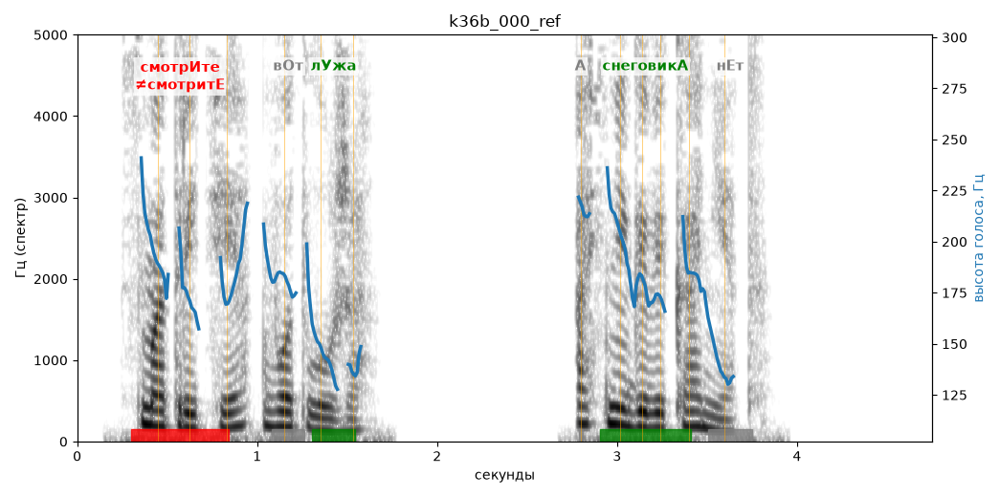

# k36b_000_ref

Голос: **edge:ru-RU-SvetlanaNeural** · длительность 4.8 с
Эталон: Смотри́те, вот лужа! А снеговика нет!
Распознано: Смотрите, вот лужа. Осниговый конец.
Расхождения в словах: «смотри те» → «смотрите»; «а снеговика нет» → «осниговый конец»

## Ударения
(где нужно: ruaccent)

| слово | нужно | у голоса | |
|---|---|---|---|
| смотрите | смотрИте | смотритЕ | ✗ ОШИБКА |
| лужа | лУжа | лУжа | ✓ |
| снеговика | снеговикА | снеговикА | ✓ |

## Интонация
- ✗ «смотрите вот лужа!» — восклицание звучит ровно, без эмоции
- ✓ «а снеговика нет!» — выделено слово «а» (+2.8 пт)
- Диапазон голоса 8.3 полутонов (живо), средняя высота 178 Гц

## Паузы и темп
- паузы на своих местах
- Темп 6.1 слога/с (нормально)

_Синяя линия — высота голоса. Над словами заглавная буква — где ударение должно быть; красным — голос поставил не туда (уверенно), оранжевым — возможно._
