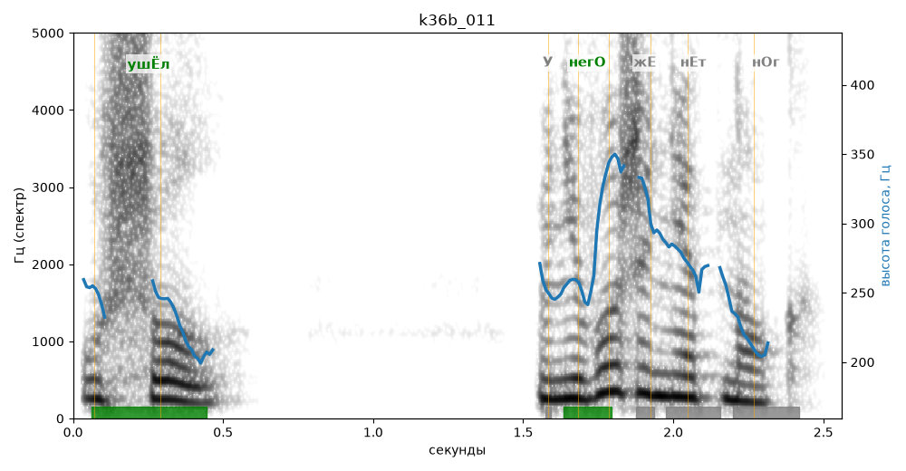

# k36b_011

Голос: **Барсик, сборка 36e** · длительность 2.6 с
Эталон: Ушёл? У него же нет ног!
Распознано: Ушел. У него же нет ног.
Слова: все совпали

## Ударения
(где нужно: ruaccent)

| слово | нужно | у голоса | |
|---|---|---|---|
| ушёл | ушЁл | ушЁл | ✓ |
| него | негО | негО | ✓ |

## Интонация
- ✓ «у него же нет ног!» — выделено слово «него» (+4.4 пт)
- Диапазон голоса 8.7 полутонов (живо), средняя высота 254 Гц

## Паузы и темп
- паузы на своих местах
- Темп 6.5 слога/с (нормально)

_Синяя линия — высота голоса. Над словами заглавная буква — где ударение должно быть; красным — голос поставил не туда (уверенно), оранжевым — возможно._
