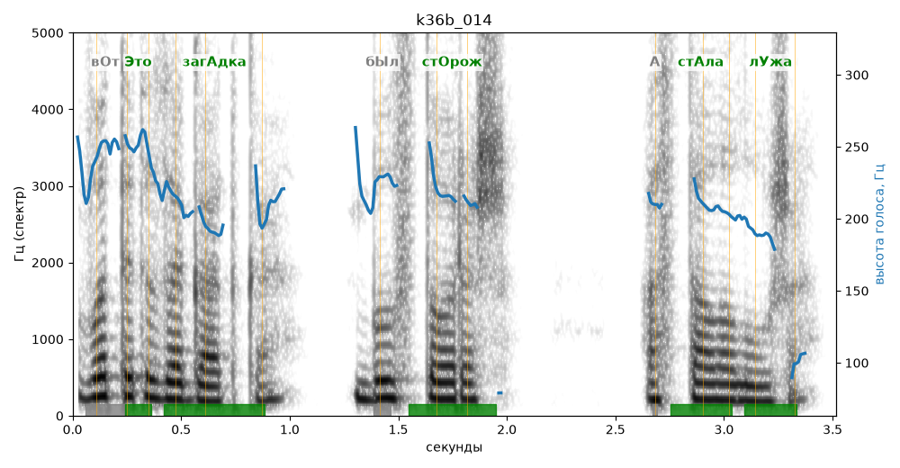

# k36b_014

Голос: **Барсик, сборка 36e** · длительность 3.5 с
Эталон: Вот это загадка. Был сторож — а стала лужа.
Распознано: Вот эта загадка был старож, остала лужа.
Расхождения в словах: «это» → «эта»; «сторож а стала» → «старож остала»

## Ударения
(где нужно: ruaccent)

| слово | нужно | у голоса | |
|---|---|---|---|
| это | Это | Это | ✓ |
| загадка | загАдка | загАдка | ✓ |
| сторож | стОрож | стОрож | ✓ |
| стала | стАла | стАла | ✓ |
| лужа | лУжа | лУжа | ✓ |

## Интонация
- ✓ «вот это загадка.» — конец фразы понижается — звучит законченно
- ✓ «был сторож а стала лужа.» — конец фразы понижается — звучит законченно
- Диапазон голоса 10.1 полутонов (живо), средняя высота 212 Гц

## Паузы и темп
- паузы на своих местах
- Темп 6.8 слога/с (быстро)

_Синяя линия — высота голоса. Над словами заглавная буква — где ударение должно быть; красным — голос поставил не туда (уверенно), оранжевым — возможно._
