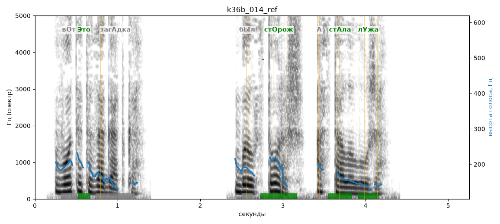

# k36b_014_ref

Голос: **edge:ru-RU-SvetlanaNeural** · длительность 5.3 с
Эталон: Вот это загадка. Был сторож — а стала лужа.
Распознано: Вот эта загадка. Был сторож, остало лужа.
Расхождения в словах: «это» → «эта»; «а стала» → «остало»

## Ударения
(где нужно: ruaccent)

| слово | нужно | у голоса | |
|---|---|---|---|
| это | Это | Это | ✓ |
| загадка | загАдка | зАгадка | ? не разобрать |
| сторож | стОрож | стОрож | ✓ |
| стала | стАла | стАла | ✓ |
| лужа | лУжа | лУжа | ✓ |

## Интонация
- ✓ «вот это загадка.» — конец фразы понижается — звучит законченно
- ✓ «был сторож а стала лужа.» — конец фразы понижается — звучит законченно
- Диапазон голоса 7.8 полутонов (живо), средняя высота 171 Гц

## Паузы и темп
- паузы на своих местах
- Темп 6.2 слога/с (нормально)

_Синяя линия — высота голоса. Над словами заглавная буква — где ударение должно быть; красным — голос поставил не туда (уверенно), оранжевым — возможно._
