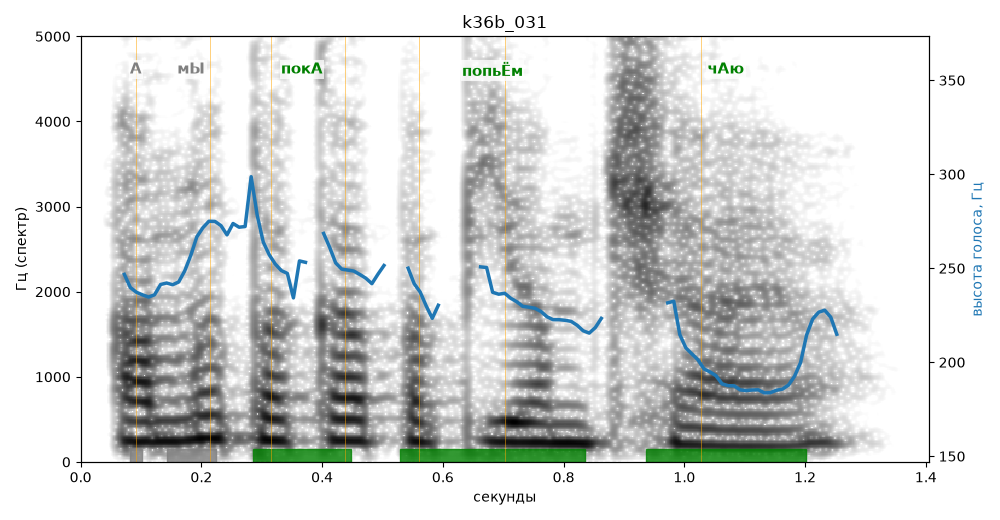

# k36b_031

Голос: **Барсик, сборка 36e** · длительность 1.4 с
Эталон: А мы пока попьём чаю.
Распознано: А ну пока попьем чаю.
Расхождения в словах: «мы» → «ну»

## Ударения
(где нужно: ruaccent)

| слово | нужно | у голоса | |
|---|---|---|---|
| пока | покА | покА | ✓ |
| попьём | попьЁм | попьЁм | ✓ |
| чаю | чАю | чАю | ✓ |

## Интонация
- ✓ «а мы пока попьём чаю.» — конец фразы понижается — звучит законченно
- Диапазон голоса 6.7 полутонов (нормально), средняя высота 234 Гц

## Паузы и темп
- паузы на своих местах
- Темп 6.3 слога/с (нормально)

_Синяя линия — высота голоса. Над словами заглавная буква — где ударение должно быть; красным — голос поставил не туда (уверенно), оранжевым — возможно._
