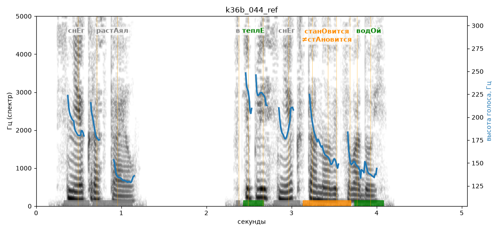

# k36b_044_ref

Голос: **edge:ru-RU-SvetlanaNeural** · длительность 5.1 с
Эталон: Снег растаял. В тепле снег становится водой.
Распознано: Снек расстал. В тепле снег становится водой.
Расхождения в словах: «снег растаял» → «снек расстал»

## Ударения
(где нужно: ruaccent)

| слово | нужно | у голоса | |
|---|---|---|---|
| растаял | растАял | — | ? |
| тепле | теплЕ | теплЕ | ✓ |
| становится | станОвится | стАновится | ✗? возможно — послушать |
| водой | водОй | водОй | ✓ |

## Интонация
- ✓ «снег растаял.» — конец фразы понижается — звучит законченно
- ✓ «в тепле снег становится водой.» — конец фразы понижается — звучит законченно
- Диапазон голоса 9.5 полутонов (живо), средняя высота 174 Гц

## Паузы и темп
- паузы на своих местах
- Темп 5.1 слога/с (нормально)

_Синяя линия — высота голоса. Над словами заглавная буква — где ударение должно быть; красным — голос поставил не туда (уверенно), оранжевым — возможно._
