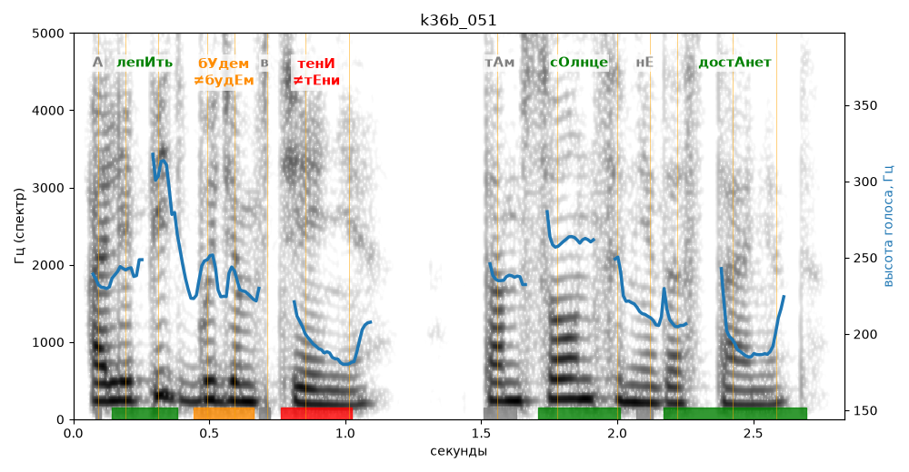

# k36b_051

Голос: **Барсик, сборка 36e** · длительность 2.8 с
Эталон: А лепить будем в тени. Там солнце не достанет.
Распознано: А лепить будем в тени, там солнце не достанет.
Слова: все совпали

## Ударения
(где нужно: ruaccent)

| слово | нужно | у голоса | |
|---|---|---|---|
| лепить | лепИть | лепИть | ✓ |
| будем | бУдем | будЕм | ✗? возможно — послушать |
| тени | тенИ | тЕни | ✗ ОШИБКА |
| солнце | сОлнце | сОлнце | ✓ |
| достанет | достАнет | достАнет | ✓ |

## Интонация
- ✓ «а лепить будем в тени.» — конец фразы понижается — звучит законченно
- ✓ «там солнце не достанет.» — конец фразы понижается — звучит законченно
- Диапазон голоса 7.1 полутонов (живо), средняя высота 228 Гц

## Паузы и темп
- паузы на своих местах
- Темп 7.0 слога/с (быстро)

_Синяя линия — высота голоса. Над словами заглавная буква — где ударение должно быть; красным — голос поставил не туда (уверенно), оранжевым — возможно._
