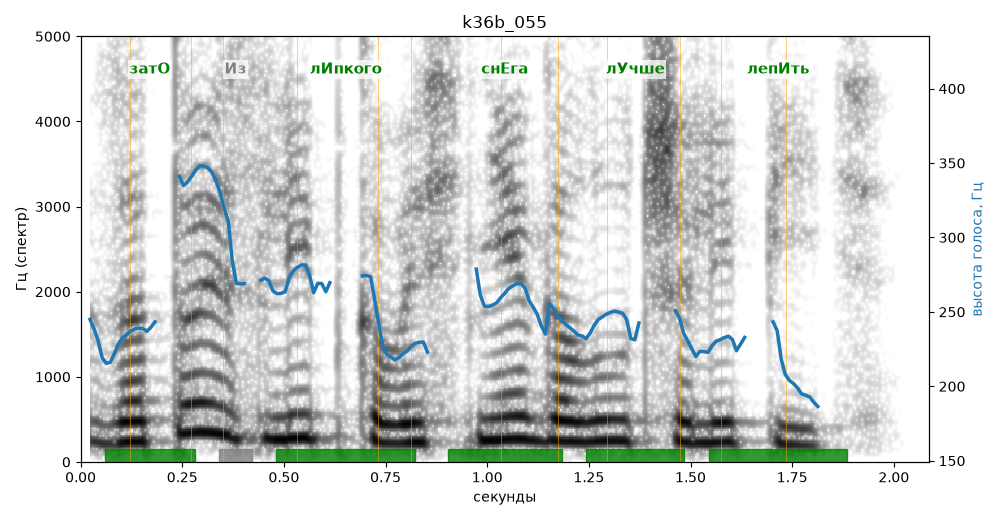

# k36b_055

Голос: **Барсик, сборка 36e** · длительность 2.1 с
Эталон: Зато из липкого снега лучше лепить!
Распознано: Зато из липкого снега лучше лепить.
Слова: все совпали

## Ударения
(где нужно: ruaccent)

| слово | нужно | у голоса | |
|---|---|---|---|
| зато | затО | затО | ✓ |
| липкого | лИпкого | лИпкого | ✓ |
| снега | снЕга | снЕга | ✓ |
| лучше | лУчше | лУчше | ✓ |
| лепить | лепИть | лепИть | ✓ |

## Интонация
- ✓ «зато из липкого снега лучше лепить!» — выделено слово «зато» (+5.9 пт)
- Диапазон голоса 8.8 полутонов (живо), средняя высота 244 Гц

## Паузы и темп
- паузы на своих местах
- Темп 6.6 слога/с (быстро)

_Синяя линия — высота голоса. Над словами заглавная буква — где ударение должно быть; красным — голос поставил не туда (уверенно), оранжевым — возможно._
