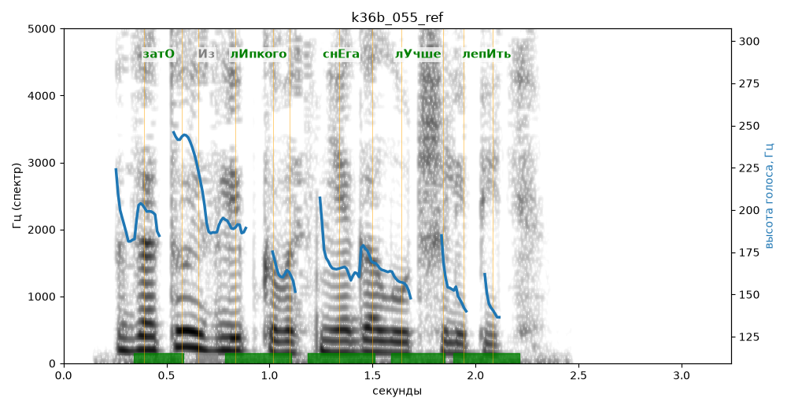

# k36b_055_ref

Голос: **edge:ru-RU-SvetlanaNeural** · длительность 3.2 с
Эталон: Зато́ из липкого сне́га лучше лепить!
Распознано: Зато из липкого снега лучше лепить.
Расхождения в словах: «сне га» → «снега»

## Ударения
(где нужно: ruaccent)

| слово | нужно | у голоса | |
|---|---|---|---|
| зато | затО | затО | ✓ |
| липкого | лИпкого | лИпкого | ✓ |
| снега | снЕга | снЕга | ✓ |
| лучше | лУчше | лУчше | ✓ |
| лепить | лепИть | лепИть | ✓ |

## Интонация
- ✓ «зато из липкого снега лучше лепить!» — выделено слово «зато» (+6.7 пт)
- Диапазон голоса 9.0 полутонов (живо), средняя высота 172 Гц

## Паузы и темп
- паузы на своих местах
- Темп 6.4 слога/с (нормально)

_Синяя линия — высота голоса. Над словами заглавная буква — где ударение должно быть; красным — голос поставил не туда (уверенно), оранжевым — возможно._
