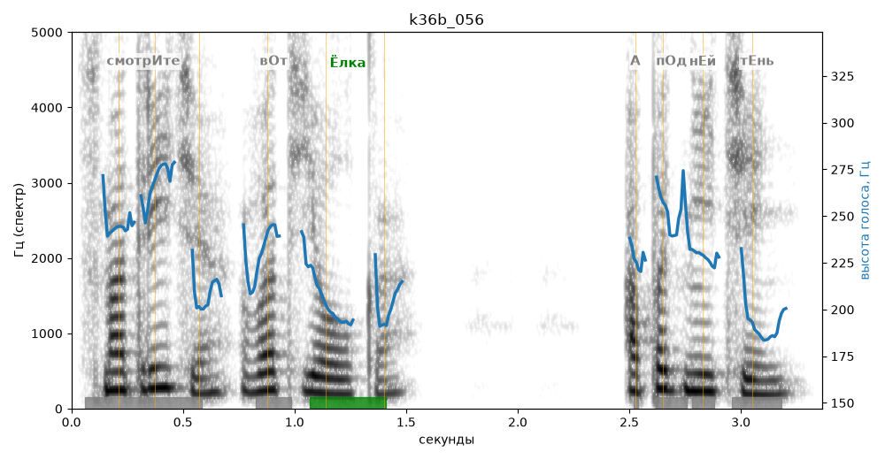

# k36b_056

Голос: **Барсик, сборка 36e** · длительность 3.4 с
Эталон: Смотрите, вот ёлка. А под ней тень.
Распознано: Смотрите, вот ёлка. Оподнятень.
Расхождения в словах: «а под ней тень» → «оподнятень»

## Ударения
(где нужно: ruaccent)

| слово | нужно | у голоса | |
|---|---|---|---|
| смотрите | смотрИте | смотритЕ | ? не разобрать |
| ёлка | Ёлка | Ёлка | ✓ |

## Интонация
- ✓ «смотрите вот ёлка.» — конец фразы понижается — звучит законченно
- ✓ «а под ней тень.» — конец фразы понижается — звучит законченно
- Диапазон голоса 6.5 полутонов (нормально), средняя высота 226 Гц

## Паузы и темп
- паузы на своих местах
- Темп 5.6 слога/с (нормально)

_Синяя линия — высота голоса. Над словами заглавная буква — где ударение должно быть; красным — голос поставил не туда (уверенно), оранжевым — возможно._
