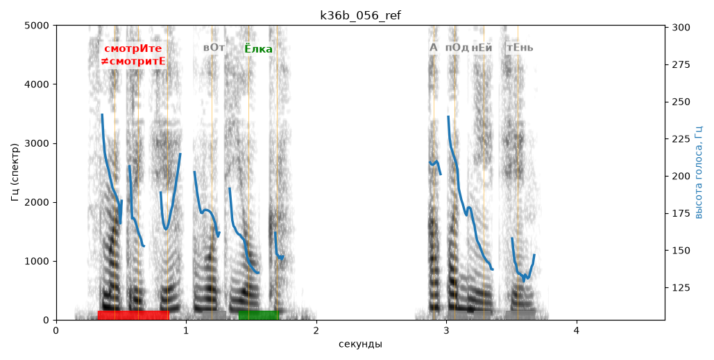

# k36b_056_ref

Голос: **edge:ru-RU-SvetlanaNeural** · длительность 4.7 с
Эталон: Смотри́те, вот ёлка. А под ней тень.
Распознано: Смотрите, вот ёлка. А поднетень.
Расхождения в словах: «смотри те» → «смотрите»; «под ней тень» → «поднетень»

## Ударения
(где нужно: дано в тексте)

| слово | нужно | у голоса | |
|---|---|---|---|
| смотрите | смотрИте | смотритЕ | ✗ ОШИБКА |
| ёлка | Ёлка | Ёлка | ✓ |

## Интонация
- ✓ «смотрите вот ёлка.» — конец фразы понижается — звучит законченно
- ✓ «а под ней тень.» — конец фразы понижается — звучит законченно
- Диапазон голоса 8.1 полутонов (живо), средняя высота 170 Гц

## Паузы и темп
- паузы на своих местах
- Темп 5.2 слога/с (нормально)

_Синяя линия — высота голоса. Над словами заглавная буква — где ударение должно быть; красным — голос поставил не туда (уверенно), оранжевым — возможно._
