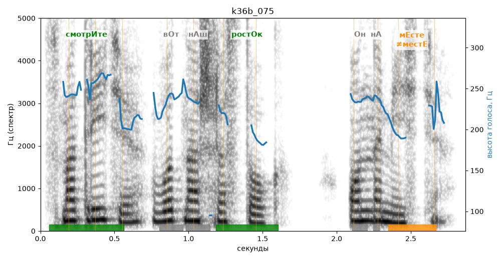

# k36b_075

Голос: **Барсик, сборка 36e** · длительность 2.9 с
Эталон: Смотрите, вот наш росток. Он на месте.
Распознано: Смотрите, вот наш расток. Он на месте.
Расхождения в словах: «росток» → «расток»

## Ударения
(где нужно: ruaccent)

| слово | нужно | у голоса | |
|---|---|---|---|
| смотрите | смотрИте | смотрИте | ✓ |
| росток | ростОк | ростОк | ✓ |
| месте | мЕсте | местЕ | ✗? возможно — послушать |

## Интонация
- ✓ «смотрите вот наш росток.» — конец фразы понижается — звучит законченно
- ✓ «он на месте.» — конец фразы понижается — звучит законченно
- Диапазон голоса 6.1 полутонов (нормально), средняя высота 233 Гц

## Паузы и темп
- паузы на своих местах
- Темп 5.9 слога/с (нормально)

_Синяя линия — высота голоса. Над словами заглавная буква — где ударение должно быть; красным — голос поставил не туда (уверенно), оранжевым — возможно._
