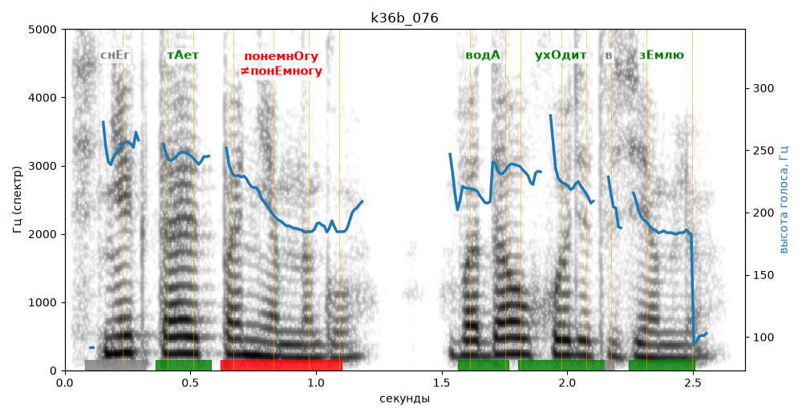

# k36b_076

Голос: **Барсик, сборка 36e** · длительность 2.7 с
Эталон: Снег тает понемногу. Вода уходит в землю.
Распознано: Снектает по нем ногу. Вода уходит в землю.
Расхождения в словах: «снег тает понемногу» → «снектает по нем ногу»

## Ударения
(где нужно: ruaccent)

| слово | нужно | у голоса | |
|---|---|---|---|
| тает | тАет | тАет | ✓ |
| понемногу | понемнОгу | понЕмногу | ✗ ОШИБКА |
| вода | водА | водА | ✓ |
| уходит | ухОдит | ухОдит | ✓ |
| землю | зЕмлю | зЕмлю | ✓ |

## Интонация
- ✓ «снег тает понемногу.» — конец фразы понижается — звучит законченно
- ✓ «вода уходит в землю.» — конец фразы понижается — звучит законченно
- Диапазон голоса 5.8 полутонов (нормально), средняя высота 216 Гц

## Паузы и темп
- паузы на своих местах
- Темп 7.6 слога/с (быстро)

_Синяя линия — высота голоса. Над словами заглавная буква — где ударение должно быть; красным — голос поставил не туда (уверенно), оранжевым — возможно._
