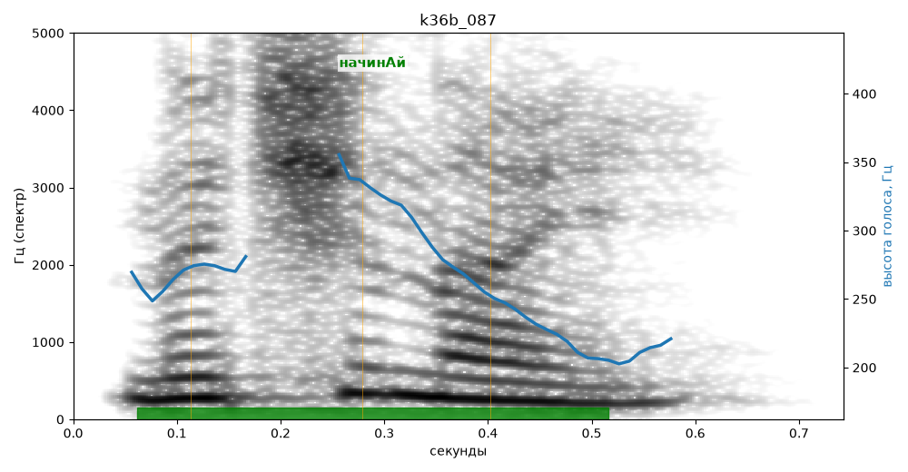

# k36b_087

Голос: **Барсик, сборка 36e** · длительность 0.7 с
Эталон: Начинай!
Распознано: Начинай.
Слова: все совпали

## Ударения
(где нужно: ruaccent)

| слово | нужно | у голоса | |
|---|---|---|---|
| начинай | начинАй | начинАй | ✓ |

## Интонация
- ✗ «начинай!» — восклицание звучит ровно, без эмоции
- Диапазон голоса 8.5 полутонов (живо), средняя высота 262 Гц

## Паузы и темп
- паузы на своих местах
- Темп 6.6 слога/с (быстро)

_Синяя линия — высота голоса. Над словами заглавная буква — где ударение должно быть; красным — голос поставил не туда (уверенно), оранжевым — возможно._
