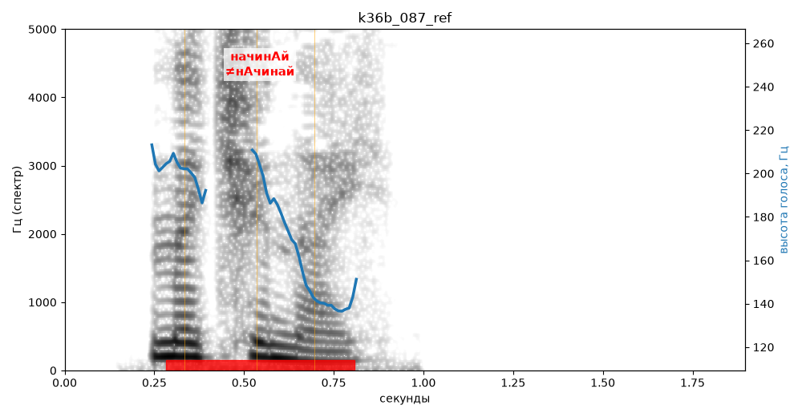

# k36b_087_ref

Голос: **edge:ru-RU-SvetlanaNeural** · длительность 1.9 с
Эталон: Начинай!
Распознано: Начинай.
Слова: все совпали

## Ударения
(где нужно: ruaccent)

| слово | нужно | у голоса | |
|---|---|---|---|
| начинай | начинАй | нАчинай | ✗ ОШИБКА |

## Интонация
- ✗ «начинай!» — восклицание звучит ровно, без эмоции
- Диапазон голоса 7.3 полутонов (живо), средняя высота 186 Гц

## Паузы и темп
- паузы на своих местах
- Темп 5.7 слога/с (нормально)

_Синяя линия — высота голоса. Над словами заглавная буква — где ударение должно быть; красным — голос поставил не туда (уверенно), оранжевым — возможно._
