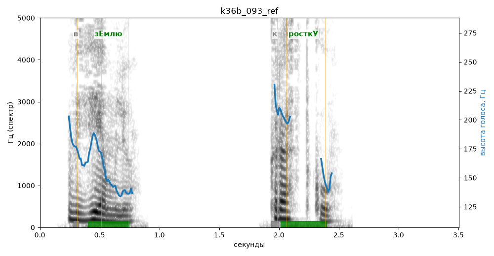

# k36b_093_ref

Голос: **edge:ru-RU-SvetlanaNeural** · длительность 3.5 с
Эталон: В землю. К ростку.
Распознано: В землю. Краску.
Расхождения в словах: «к ростку» → «краску»

## Ударения
(где нужно: ruaccent)

| слово | нужно | у голоса | |
|---|---|---|---|
| землю | зЕмлю | зЕмлю | ✓ |
| ростку | росткУ | росткУ | ✓ |

## Интонация
- ✗ «в землю.» — конец фразы не понижается — звучит незаконченно / как перечисление
- ✓ «к ростку.» — конец фразы понижается — звучит законченно
- Диапазон голоса 7.3 полутонов (живо), средняя высота 164 Гц

## Паузы и темп
- паузы на своих местах
- Темп 6.5 слога/с (нормально)

_Синяя линия — высота голоса. Над словами заглавная буква — где ударение должно быть; красным — голос поставил не туда (уверенно), оранжевым — возможно._
