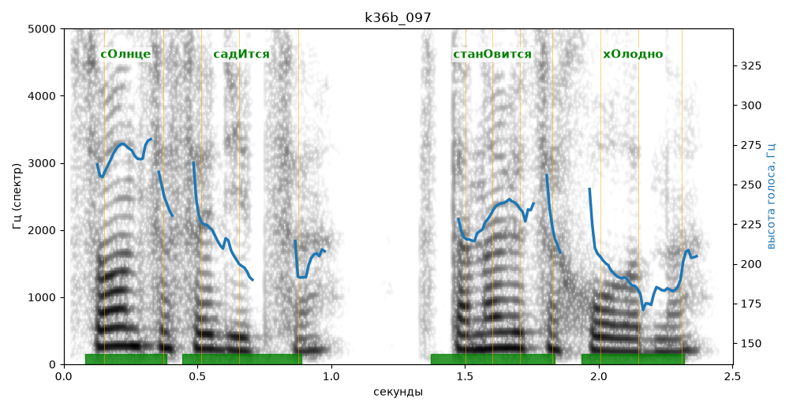

# k36b_097

Голос: **Барсик, сборка 36e** · длительность 2.5 с
Эталон: Солнце садится. Становится холодно.
Распознано: Солнце садится, становится холодно.
Слова: все совпали

## Ударения
(где нужно: ruaccent)

| слово | нужно | у голоса | |
|---|---|---|---|
| солнце | сОлнце | сОлнце | ✓ |
| садится | садИтся | садИтся | ✓ |
| становится | станОвится | станОвится | ✓ |
| холодно | хОлодно | хОлодно | ✓ |

## Интонация
- ✓ «солнце садится.» — конец фразы понижается — звучит законченно
- ✓ «становится холодно.» — конец фразы понижается — звучит законченно
- Диапазон голоса 6.9 полутонов (нормально), средняя высота 215 Гц

## Паузы и темп
- паузы на своих местах
- Темп 6.8 слога/с (быстро)

_Синяя линия — высота голоса. Над словами заглавная буква — где ударение должно быть; красным — голос поставил не туда (уверенно), оранжевым — возможно._
