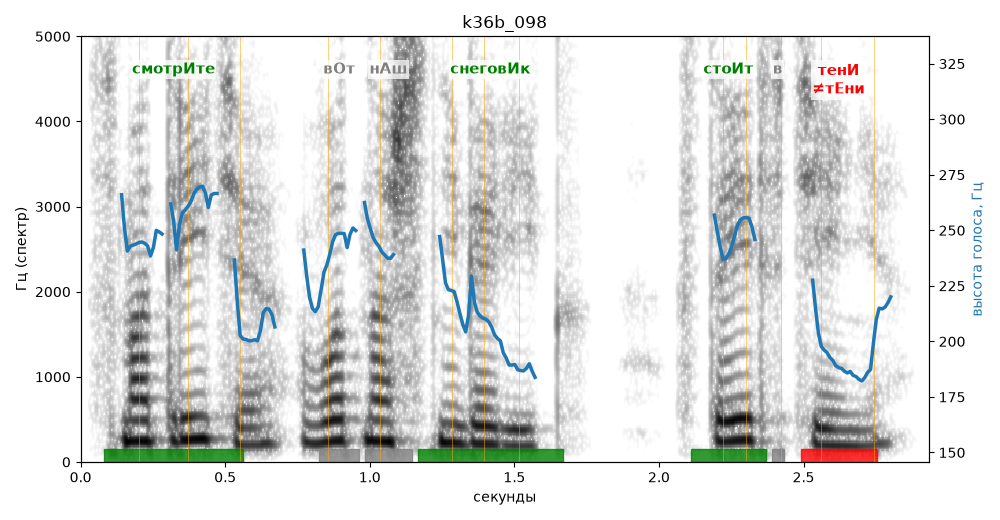

# k36b_098

Голос: **Барсик, сборка 36e** · длительность 2.9 с
Эталон: Смотрите, вот наш снеговик. Стоит в тени.
Распознано: Смотрите, вот наш снегорик, стоит в тени.
Расхождения в словах: «снеговик» → «снегорик»

## Ударения
(где нужно: ruaccent)

| слово | нужно | у голоса | |
|---|---|---|---|
| смотрите | смотрИте | смотрИте | ✓ |
| снеговик | снеговИк | снеговИк | ✓ |
| стоит | стоИт | стоИт | ✓ |
| тени | тенИ | тЕни | ✗ ОШИБКА |

## Интонация
- ✓ «смотрите вот наш снеговик.» — конец фразы понижается — звучит законченно
- ✓ «стоит в тени.» — конец фразы понижается — звучит законченно
- Диапазон голоса 6.2 полутонов (нормально), средняя высота 227 Гц

## Паузы и темп
- паузы на своих местах
- Темп 6.6 слога/с (быстро)

_Синяя линия — высота голоса. Над словами заглавная буква — где ударение должно быть; красным — голос поставил не туда (уверенно), оранжевым — возможно._
