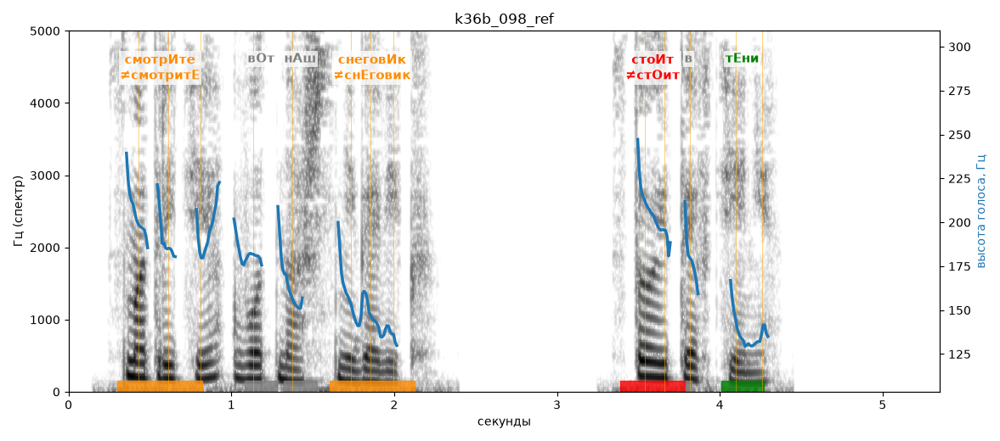

# k36b_098_ref

Голос: **edge:ru-RU-SvetlanaNeural** · длительность 5.4 с
Эталон: Смотри́те, вот наш снеговик. Стои́т в те́ни.
Распознано: Смотрите, вот наш снеговик. Стоит эфтене.
Расхождения в словах: «смотри те» → «смотрите»; «стои т в те ни» → «стоит эфтене»

## Ударения
(где нужно: ruaccent)

| слово | нужно | у голоса | |
|---|---|---|---|
| смотрите | смотрИте | смотритЕ | ✗? возможно — послушать |
| снеговик | снеговИк | снЕговик | ✗? возможно — послушать |
| стоит | стоИт | стОит | ✗ ОШИБКА |
| тени | тЕни | тЕни | ✓ |

## Интонация
- ✓ «смотрите вот наш снеговик.» — конец фразы понижается — звучит законченно
- ✓ «стоит в тени.» — конец фразы понижается — звучит законченно
- Диапазон голоса 8.6 полутонов (живо), средняя высота 180 Гц

## Паузы и темп
- паузы на своих местах
- Темп 5.7 слога/с (нормально)

_Синяя линия — высота голоса. Над словами заглавная буква — где ударение должно быть; красным — голос поставил не туда (уверенно), оранжевым — возможно._
