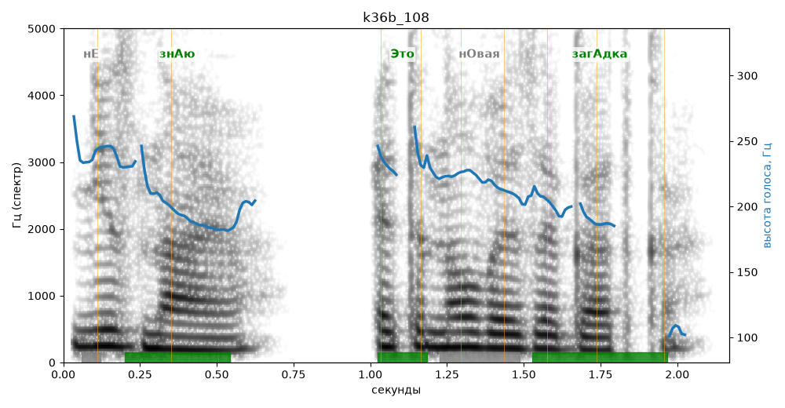

# k36b_108

Голос: **Барсик, сборка 36e** · длительность 2.2 с
Эталон: Не знаю. Это новая загадка.
Распознано: Не знаю, это новая загадка.
Слова: все совпали

## Ударения
(где нужно: ruaccent)

| слово | нужно | у голоса | |
|---|---|---|---|
| знаю | знАю | знАю | ✓ |
| это | Это | Это | ✓ |
| новая | нОвая | — | ? |
| загадка | загАдка | загАдка | ✓ |

## Интонация
- ✓ «это новая загадка.» — конец фразы понижается — звучит законченно
- Диапазон голоса 5.2 полутонов (нормально), средняя высота 210 Гц

## Паузы и темп
- паузы на своих местах
- Темп 6.3 слога/с (нормально)

_Синяя линия — высота голоса. Над словами заглавная буква — где ударение должно быть; красным — голос поставил не туда (уверенно), оранжевым — возможно._
