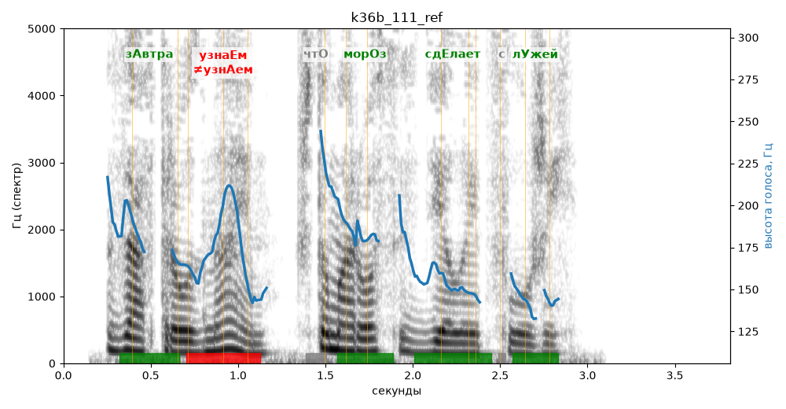

# k36b_111_ref

Голос: **edge:ru-RU-SvetlanaNeural** · длительность 3.8 с
Эталон: Завтра узнаем, что мороз сделает с лужей.
Распознано: Завтра узнаем, что Морос сделает служей.
Расхождения в словах: «мороз» → «морос»; «с лужей» → «служей»

## Ударения
(где нужно: ruaccent)

| слово | нужно | у голоса | |
|---|---|---|---|
| завтра | зАвтра | зАвтра | ✓ |
| узнаем | узнаЕм | узнАем | ✗ ОШИБКА |
| мороз | морОз | морОз | ✓ |
| сделает | сдЕлает | сдЕлает | ✓ |
| лужей | лУжей | лУжей | ✓ |

## Интонация
- ✓ «завтра узнаем что мороз сделает с лужей.» — конец фразы понижается — звучит законченно
- Диапазон голоса 6.8 полутонов (нормально), средняя высота 166 Гц

## Паузы и темп
- паузы на своих местах
- Темп 6.2 слога/с (нормально)

_Синяя линия — высота голоса. Над словами заглавная буква — где ударение должно быть; красным — голос поставил не туда (уверенно), оранжевым — возможно._
