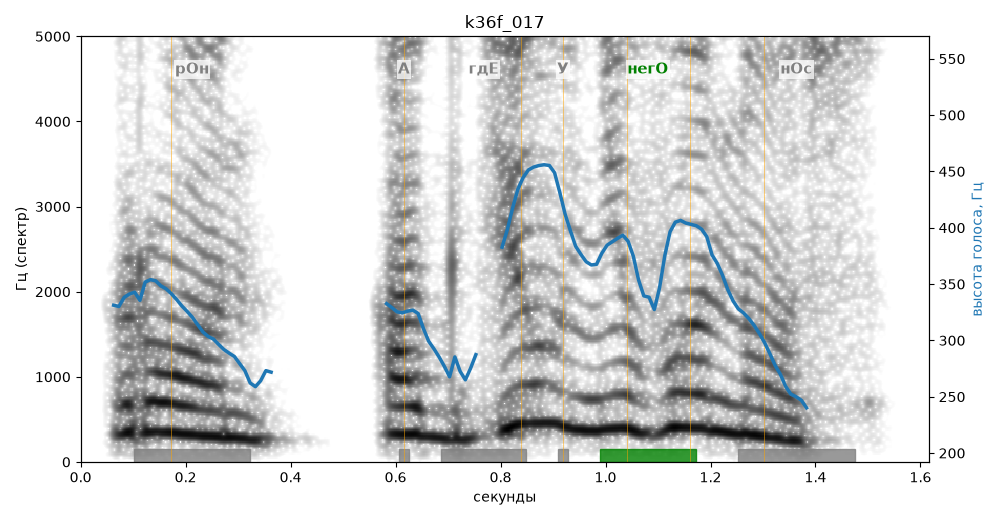

# k36f_017

Голос: **Филя, сборка 36e** · длительность 1.6 с
Эталон: Рон, а где у него нос?
Распознано: Рон, а где у него нос?
Слова: все совпали

## Ударения
(где нужно: ruaccent)

| слово | нужно | у голоса | |
|---|---|---|---|
| него | негО | негО | ✓ |

## Интонация
- ✗ «рон а где у него нос?» — нет вопросительного подъёма (самое высокое место — «где», в начале) — звучит как утверждение
- Диапазон голоса 9.4 полутонов (живо), средняя высота 335 Гц

## Паузы и темп
- паузы на своих местах
- Темп 6.4 слога/с (нормально)

_Синяя линия — высота голоса. Над словами заглавная буква — где ударение должно быть; красным — голос поставил не туда (уверенно), оранжевым — возможно._
