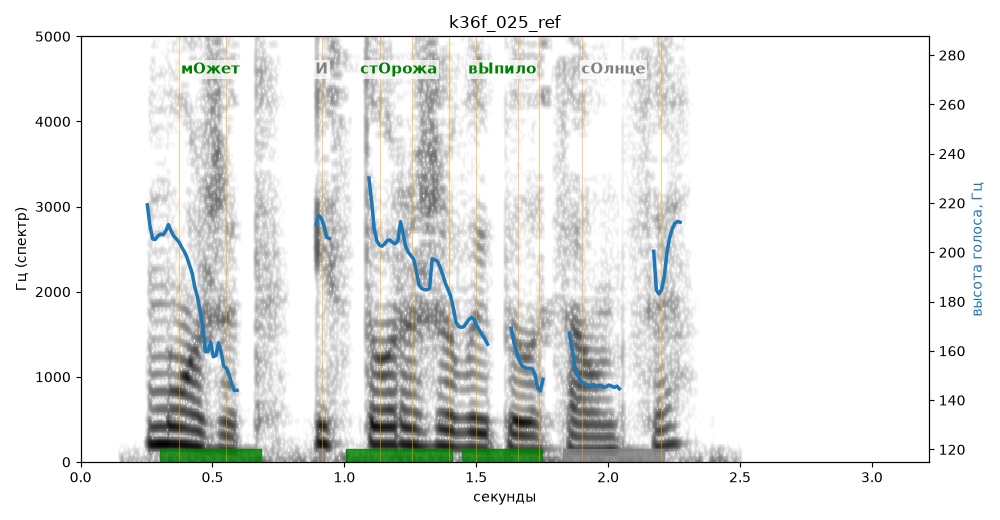

# k36f_025_ref

Голос: **edge:ru-RU-SvetlanaNeural** · длительность 3.2 с
Эталон: Может, и сторожа выпило со́лнце?
Распознано: Может, и сторожевый пилосалнце?
Расхождения в словах: «сторожа выпило со лнце» → «сторожевый пилосалнце»

## Ударения
(где нужно: ruaccent)

| слово | нужно | у голоса | |
|---|---|---|---|
| может | мОжет | мОжет | ✓ |
| сторожа | стОрожа | стОрожа | ✓ |
| выпило | вЫпило | вЫпило | ✓ |
| солнце | сОлнце | солнцЕ | ? не разобрать |

## Интонация
- ✗ «может и сторожа выпило солнце?» — нет вопросительного подъёма (самое высокое место — «и», в начале) — звучит как утверждение
- Диапазон голоса 6.6 полутонов (нормально), средняя высота 185 Гц

## Паузы и темп
- паузы на своих местах
- Темп 6.5 слога/с (нормально)

_Синяя линия — высота голоса. Над словами заглавная буква — где ударение должно быть; красным — голос поставил не туда (уверенно), оранжевым — возможно._
