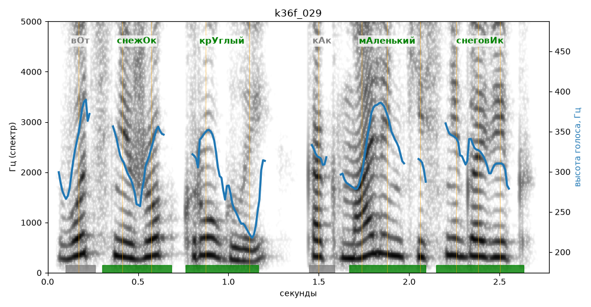

# k36f_029

Голос: **Филя, сборка 36e** · длительность 2.8 с
Эталон: Вот снежок! Круглый, как маленький снеговик!
Распознано: Вот снежок круглый, как маленький снеговик.
Слова: все совпали

## Ударения
(где нужно: ruaccent)

| слово | нужно | у голоса | |
|---|---|---|---|
| снежок | снежОк | снежОк | ✓ |
| круглый | крУглый | крУглый | ✓ |
| маленький | мАленький | мАленький | ✓ |
| снеговик | снеговИк | снеговИк | ✓ |

## Интонация
- ✗ «вот снежок!» — восклицание звучит ровно, без эмоции
- ✗ «круглый как маленький снеговик!» — восклицание звучит ровно, без эмоции
- Диапазон голоса 8.1 полутонов (живо), средняя высота 314 Гц

## Паузы и темп
- после «снежок!» пауза всего 0.08 с — фразы слипаются
- Темп 5.3 слога/с (нормально)

_Синяя линия — высота голоса. Над словами заглавная буква — где ударение должно быть; красным — голос поставил не туда (уверенно), оранжевым — возможно._
