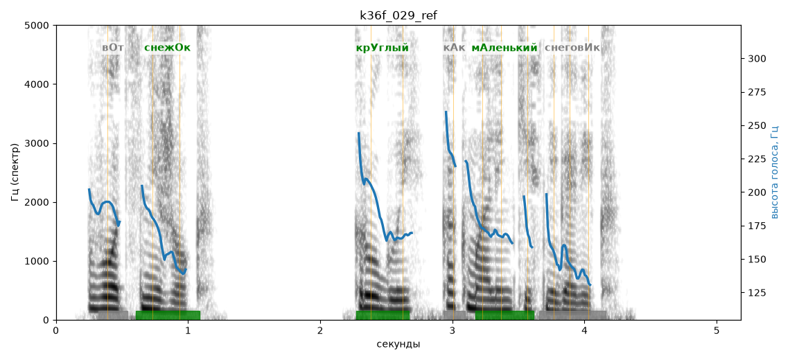

# k36f_029_ref

Голос: **edge:ru-RU-SvetlanaNeural** · длительность 5.2 с
Эталон: Вот снежок! Круглый, как маленький снеговик!
Распознано: Вот снежок. Круглый, как маленький снеговик.
Слова: все совпали

## Ударения
(где нужно: ruaccent)

| слово | нужно | у голоса | |
|---|---|---|---|
| снежок | снежОк | снежОк | ✓ |
| круглый | крУглый | крУглый | ✓ |
| маленький | мАленький | мАленький | ✓ |
| снеговик | снеговИк | снЕговик | ? не разобрать |

## Интонация
- ✗ «вот снежок!» — восклицание звучит ровно, без эмоции
- ✓ «круглый как маленький снеговик!» — выделено слово «как» (+5.3 пт)
- Диапазон голоса 8.1 полутонов (живо), средняя высота 170 Гц

## Паузы и темп
- паузы на своих местах
- Темп 5.0 слога/с (нормально)

_Синяя линия — высота голоса. Над словами заглавная буква — где ударение должно быть; красным — голос поставил не туда (уверенно), оранжевым — возможно._
