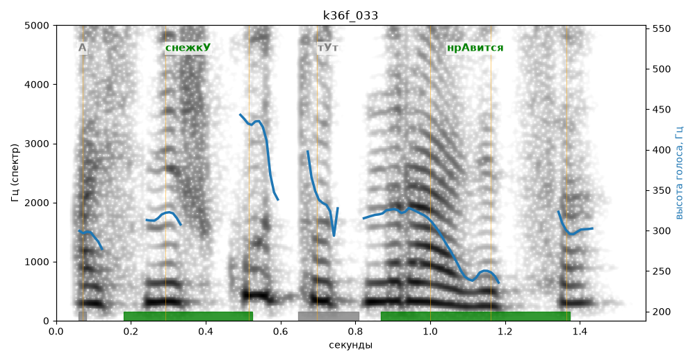

# k36f_033

Голос: **Филя, сборка 36e** · длительность 1.6 с
Эталон: А снежку тут нравится?
Распознано: А снижку тут нравится.
Расхождения в словах: «снежку» → «снижку»

## Ударения
(где нужно: ruaccent)

| слово | нужно | у голоса | |
|---|---|---|---|
| снежку | снежкУ | снежкУ | ✓ |
| нравится | нрАвится | нрАвится | ✓ |

## Интонация
- ✗ «а снежку тут нравится?» — нет вопросительного подъёма (самое высокое место — «снежку», в начале) — звучит как утверждение
- Диапазон голоса 10.0 полутонов (живо), средняя высота 315 Гц

## Паузы и темп
- паузы на своих местах
- Темп 5.3 слога/с (нормально)

_Синяя линия — высота голоса. Над словами заглавная буква — где ударение должно быть; красным — голос поставил не туда (уверенно), оранжевым — возможно._
