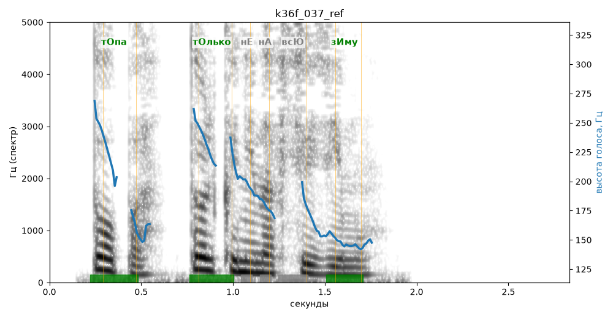

# k36f_037_ref

Голос: **edge:ru-RU-SvetlanaNeural** · длительность 2.8 с
Эталон: Топа, только не на всю зи́му!
Распознано: Топа, только не на всю зиму.
Расхождения в словах: «зи му» → «зиму»

## Ударения
(где нужно: ruaccent)

| слово | нужно | у голоса | |
|---|---|---|---|
| топа | тОпа | тОпа | ✓ |
| только | тОлько | тОлько | ✓ |
| зиму | зИму | зИму | ✓ |

## Интонация
- ✓ «топа только не на всю зиму!» — выделено слово «только» (+5.1 пт)
- Диапазон голоса 9.4 полутонов (живо), средняя высота 176 Гц

## Паузы и темп
- паузы на своих местах
- Темп 7.5 слога/с (быстро)

_Синяя линия — высота голоса. Над словами заглавная буква — где ударение должно быть; красным — голос поставил не туда (уверенно), оранжевым — возможно._
