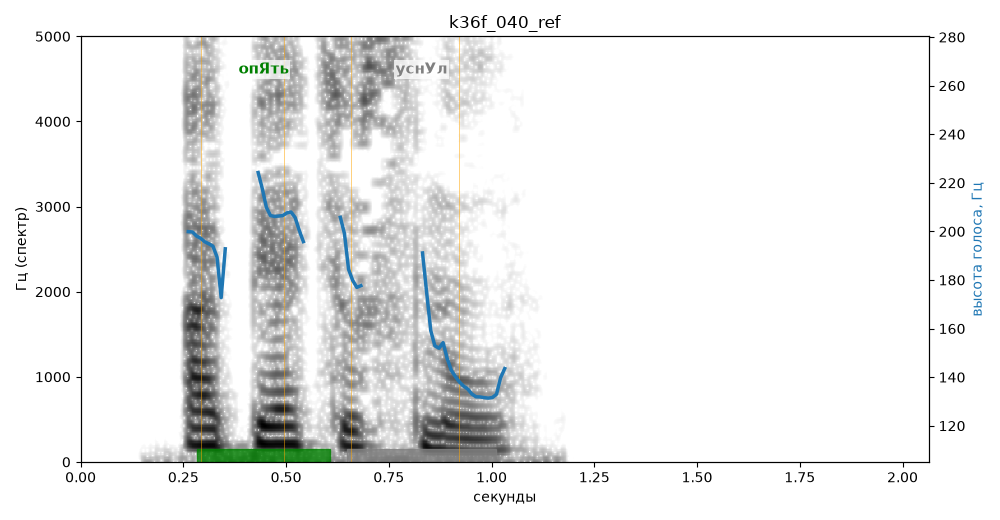

# k36f_040_ref

Голос: **edge:ru-RU-SvetlanaNeural** · длительность 2.1 с
Эталон: Опять уснул.
Распознано: опять уснул.
Слова: все совпали

## Ударения
(где нужно: ruaccent)

| слово | нужно | у голоса | |
|---|---|---|---|
| опять | опЯть | опЯть | ✓ |
| уснул | уснУл | Уснул | ? не разобрать |

## Интонация
- ✓ «опять уснул.» — конец фразы понижается — звучит законченно
- Диапазон голоса 8.0 полутонов (живо), средняя высота 184 Гц

## Паузы и темп
- паузы на своих местах
- Темп 5.5 слога/с (нормально)

_Синяя линия — высота голоса. Над словами заглавная буква — где ударение должно быть; красным — голос поставил не туда (уверенно), оранжевым — возможно._
