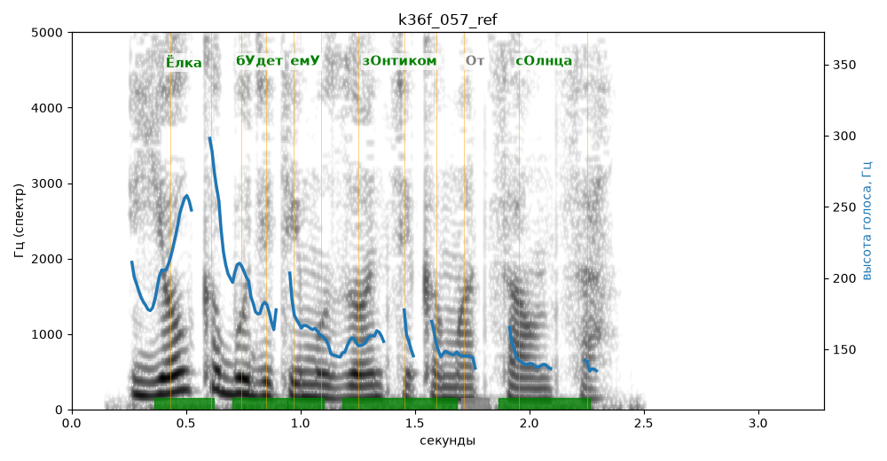

# k36f_057_ref

Голос: **edge:ru-RU-SvetlanaNeural** · длительность 3.3 с
Эталон: Ёлка будет ему́ зонтиком от со́лнца!
Распознано: Ёлка будет ему зонтиком от Солнца.
Расхождения в словах: «со лнца» → «солнца»

## Ударения
(где нужно: ruaccent)

| слово | нужно | у голоса | |
|---|---|---|---|
| ёлка | Ёлка | Ёлка | ✓ |
| будет | бУдет | бУдет | ✓ |
| ему | емУ | емУ | ✓ |
| зонтиком | зОнтиком | зОнтиком | ✓ |
| солнца | сОлнца | сОлнца | ✓ |

## Интонация
- ✓ «ёлка будет ему зонтиком от солнца!» — выделено слово «ёлка» (+5.4 пт)
- Диапазон голоса 10.6 полутонов (живо), средняя высота 163 Гц

## Паузы и темп
- паузы на своих местах
- Темп 6.3 слога/с (нормально)

_Синяя линия — высота голоса. Над словами заглавная буква — где ударение должно быть; красным — голос поставил не туда (уверенно), оранжевым — возможно._
