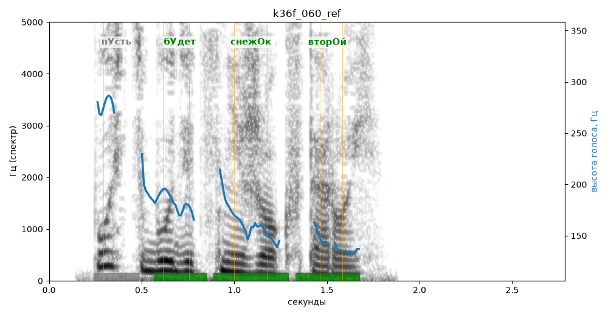

# k36f_060_ref

Голос: **edge:ru-RU-SvetlanaNeural** · длительность 2.8 с
Эталон: Пусть будет Снежок Второй!
Распознано: Пусть будет снежок второй.
Слова: все совпали

## Ударения
(где нужно: ruaccent)

| слово | нужно | у голоса | |
|---|---|---|---|
| будет | бУдет | бУдет | ✓ |
| снежок | снежОк | снежОк | ✓ |
| второй | вторОй | вторОй | ✓ |

## Интонация
- ✓ «пусть будет снежок второй!» — выделено слово «пусть» (+8.7 пт)
- Диапазон голоса 12.7 полутонов (живо), средняя высота 169 Гц

## Паузы и темп
- паузы на своих местах
- Темп 4.9 слога/с (нормально)

_Синяя линия — высота голоса. Над словами заглавная буква — где ударение должно быть; красным — голос поставил не туда (уверенно), оранжевым — возможно._
