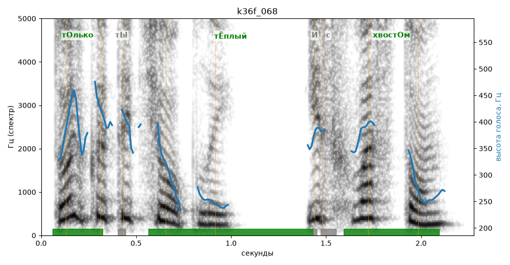

# k36f_068

Голос: **Филя, сборка 36e** · длительность 2.3 с
Эталон: Только ты тёплый. И с хвостом.
Распознано: Только ты тёплый, из хвостом.
Расхождения в словах: «и с» → «из»

## Ударения
(где нужно: ruaccent)

| слово | нужно | у голоса | |
|---|---|---|---|
| только | тОлько | тОлько | ✓ |
| тёплый | тЁплый | тЁплый | ✓ |
| хвостом | хвостОм | хвостОм | ✓ |

## Интонация
- ✓ «только ты тёплый.» — конец фразы понижается — звучит законченно
- ✓ «и с хвостом.» — конец фразы понижается — звучит законченно
- Диапазон голоса 10.0 полутонов (живо), средняя высота 345 Гц

## Паузы и темп
- после «тёплый.» пауза всего 0.00 с — фразы слипаются
- Темп 4.4 слога/с (нормально)

_Синяя линия — высота голоса. Над словами заглавная буква — где ударение должно быть; красным — голос поставил не туда (уверенно), оранжевым — возможно._
