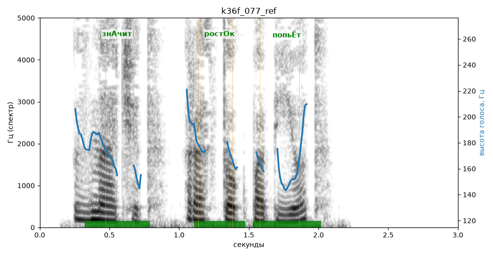

# k36f_077_ref

Голос: **edge:ru-RU-SvetlanaNeural** · длительность 3.0 с
Эталон: Значит, росток попьёт?
Распознано: Значит, росток попьет?
Слова: все совпали

## Ударения
(где нужно: ruaccent)

| слово | нужно | у голоса | |
|---|---|---|---|
| значит | знАчит | знАчит | ✓ |
| росток | ростОк | ростОк | ✓ |
| попьёт | попьЁт | попьЁт | ✓ |

## Интонация
- ✗ «значит росток попьёт?» — нет вопросительного подъёма (самое высокое место — «значит», в начале) — звучит как утверждение
- Диапазон голоса 5.7 полутонов (нормально), средняя высота 173 Гц

## Паузы и темп
- паузы на своих местах
- Темп 4.4 слога/с (нормально)

_Синяя линия — высота голоса. Над словами заглавная буква — где ударение должно быть; красным — голос поставил не туда (уверенно), оранжевым — возможно._
